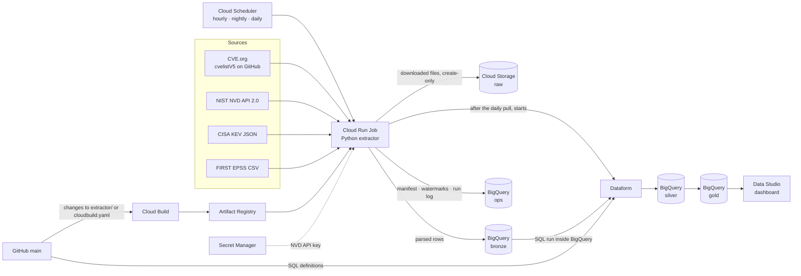
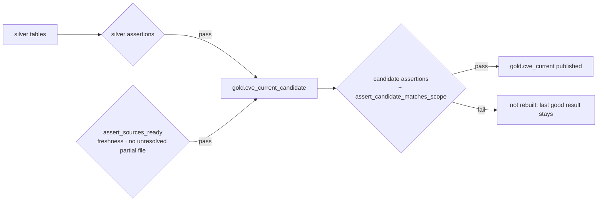

# Vulnerability Intelligence Warehouse

**An automated data warehouse on Google Cloud.** It collects four public vulnerability sources on a schedule and keeps the files it downloads in a raw layer. It cleans and joins the data in BigQuery, publishes one table only after the required checks pass, and shows the result in a dashboard. The question it answers:

> *Of the vulnerabilities published since 8 October 2026, which should a security team review first, and why?*

**[Open the live dashboard (Data Studio)](https://datastudio.google.com/reporting/c48382ca-5378-49b0-b700-a0afa693d467)**


Graduation project, Tuwaiq Academy, *Data Engineering on Google Cloud*, by **Abdullah Alshabi** (November 2026).

---

## Contents
1. [Overview](#1-overview)
2. [Architecture](#2-architecture)
3. [Sources and schedules](#3-sources-and-schedules)
4. [Data model and business rules](#4-data-model-and-business-rules)
5. [Publishing gate and verification](#5-publishing-gate-and-verification)
6. [Results and one CVE end to end](#6-results-and-one-cve-end-to-end)
7. [Setup, limitations and documentation](#7-setup-limitations-and-documentation)

---

## 1. Overview
Thousands of new vulnerabilities (CVEs) are published every week. Four public sources each answer part of the question "which ones to look at first?":

| Question | Source |
|---|---|
| What is the vulnerability, and who reported it? | **CVE.org**, the official record |
| How severe is it? | **CVSS** scores from CVE.org and **NIST NVD** |
| Is it listed as exploited? | **CISA KEV**, the catalog of known exploited vulnerabilities |
| How likely is exploitation activity in the next 30 days? | **FIRST EPSS**, a daily probability model |

The warehouse joins them into **one row per CVE** with a **Review Priority** and a plain-English **reason**. Each row keeps:
- **the provenance of the selected CVSS score:** its version, provider and route;
- **references to the source records used:** record fingerprints;
- **the EPSS and KEV snapshot it was built from:** the EPSS score date and the KEV catalog version.

| Priority | Project rule (checked in order; the first match wins) |
|---|---|
| **P1** | Listed in CISA KEV |
| **P2** | EPSS ≥ 10% |
| **P3** | CVSS ≥ 9.0 |
| **Other** | None of the above. **This does not mean safe.** |

---

## 2. Architecture


| Service | Role |
|---|---|
| **Cloud Storage** | Raw layer. Files are written create-only, and locks prevent two runs on the same source. |
| **Cloud Run Jobs** | The Python extractor: download, store raw, load bronze. |
| **Cloud Scheduler** | Starts the job on three schedules. |
| **BigQuery** | Datasets `bronze`, `silver`, `gold` and `ops`. |
| **Dataform** | SQL transformations, dependencies, column descriptions and assertions, versioned in Git. |
| **Data Studio** | The dashboard, which reads `gold.cve_current` only. |
| **Cloud Build + Artifact Registry** | CI/CD for the extractor image. |
| **Secret Manager + IAM** | Secrets, plus one least-privilege service account per component. |

**Why these tools:**
- **Cloud Run Jobs + Python for ingestion.** The hard part is control logic: pagination, retries, idempotency, locks and validation.
- **BigQuery + Dataform for transformations.** The data is modest (about 21 thousand CVEs, plus about 405 thousand EPSS rows a day), so SQL handles it in seconds. Dataform adds dependencies, assertions and versioning.
- **No Dataflow or Composer.** Dataflow is not needed because the current requirements are met without an extra processing engine. Composer is not needed because three schedules do not need a full orchestrator.

The operational details are in **[docs/operations.md](docs/operations.md)**: the ingestion sequence, run modes, service accounts and CI/CD.

---

## 3. Sources and schedules
| Source | What we use | How we read it |
|---|---|---|
| [CVE.org cvelistV5](https://github.com/CVEProject/cvelistV5) | State, dates, CNA, title, description, affected products, CNA and ADP CVSS | GitHub release ZIPs: an hourly delta and a full nightly baseline |
| [NIST NVD API 2.0](https://nvd.nist.gov/developers/vulnerabilities) | NVD status, NVD CVSS | Incremental by `lastModified`, paginated, validated per page and per record |
| [CISA KEV](https://www.cisa.gov/known-exploited-vulnerabilities-catalog) | Membership, `dateAdded`, ransomware use | The full catalog. It is used only if the stored members equal CISA's own count. |
| [FIRST EPSS](https://www.first.org/epss/) | Score, percentile, model version | The full daily file, with automatic gap filling |

| Schedule (UTC) | Cron | What runs |
|---|---|---|
| `vuln-hourly` | `15 * * * *` | The CVE.org hourly delta |
| `vuln-baseline` | `40 0 * * *` | The full CVE.org baseline (a nightly safety net) |
| `vuln-daily` | `20 6 * * *` | NVD, then KEV, then EPSS, then the Dataform workflow |

**Scope:** CVEs whose CVE.org `datePublished` is on or after **2026-10-08** (a fixed cohort). Updates to CVEs already stored are always accepted, and silver decides membership from the latest version.

**Ingestion guarantees:**
- **Raw files are not overwritten.** The ingestion code uses create-only writes (`if_generation_match=0`) to avoid overwriting existing raw objects.
- **Loads are idempotent.** Re-running a file adds no rows.
  - **CVE.org, NVD and KEV:** a changed record is stored as a **new record version**, keyed by `record_hash`.
  - **EPSS:** a different value for an existing `(cve_id, score_date)` is a **conflict**. Nothing is inserted, and the run fails.
- **Every bronze row is traceable.** Each row carries the `batch_id` of its file, and the manifest records the file URI, sha256 and row counts.
- **An incomplete load is a failure.** A file with broken records, an invalid NVD page or a KEV count mismatch fails the run, and the watermark does not move.
- **EPSS can be reprocessed.** Stored EPSS files can be reprocessed to rebuild EPSS data; this path has been tested.

---

## 4. Data model and business rules
| Layer | What it holds |
|---|---|
| **raw** (`gs://vuln-intel-warehouse-raw/raw/<source>/ingest_date=…/`) | The downloaded files |
| **bronze** | Append-only. <ul><li>**CVE.org, NVD and KEV:** one row per stored record version, with the source JSON.</li><li>**EPSS:** typed rows, one per `(cve_id, score_date)`.</li></ul> |
| **silver** | The latest valid version per CVE and source, the CVSS metrics, and the selected CVSS score |
| **gold** | **The published result:** one row per CVE in scope |
| **ops** | Manifest, watermarks, run log, EPSS day status and assertion results |

| Table | Grain | Purpose |
|---|---|---|
| `silver.cve_latest` | CVE | Newest CVE.org version; scope applied after choosing it |
| `silver.nvd_latest` | CVE | Newest NVD version |
| `silver.kev_current` | CVE | Membership in the latest **valid** KEV catalog |
| `silver.epss_latest` | CVE | Scores from the latest **complete** EPSS day |
| `silver.cve_metrics` | Score | CVSS metrics extracted from stored source-record versions, linked by `record_hash`. Current-version selection is applied in `cvss_selected`. |
| `silver.cvss_selected` | CVE | The one CVSS score chosen by the rule below, and why |
| `gold.cve_current_candidate` | CVE | The candidate result, built and checked first |
| **`gold.cve_current`** | CVE | **The published result** read by the dashboard |
| `gold.coverage_summary` | One row | Summary counts from `gold.cve_current` |

Every gold column is documented in **[docs/data_dictionary.md](docs/data_dictionary.md)**. The same descriptions are stored on the BigQuery columns and appear in the dashboard.

### CVSS selection (one score per CVE)
1. **Version:** 4.0, then 3.1, then 3.0, then 2.0.
2. **Provider, within the version:**
   1. the CNA via CVE.org;
   2. CISA-ADP;
   3. NVD-authored;
   4. another ADP;
   5. a non-NVD score read via NVD (the fallback).
3. **Scenario:** the GENERAL (or unspecified) scenario first.
4. **Score:** the highest base score among scores still tied, then a fixed tie-break.

This is a project policy, not a claim that one provider is more accurate.

### Review Priority
The rule is a sequential CASE: P1, then P2, then P3, then Other. A missing value never counts as low. `priority_reason` explains each row, for example:
- `In CISA KEV (added 2026-11-09)`
- `Not in KEV; EPSS 1.65% is below 10%; CVSS 9.8 (v3.1, CNA microsoft) is at or above 9.0`
- `Not in KEV; CVSS unavailable; EPSS unavailable. Not assessed as safe.`

**The EPSS text is truncated, never rounded up past the threshold:** 0.09999 reads 9.99%. This is a **general review priority**, not a remediation order for an organisation, and the thresholds are project choices.

---

## 5. Publishing gate and verification
**Gold is published only after all Dataform assertions configured as publication dependencies pass.** If one fails, `gold.cve_current` is not rebuilt, and the dashboard keeps the last good result with its real build time. **The additional verification scripts below are run separately; they are not part of the gate.**



**Assertions in the gate:**
- uniqueness, required fields, value ranges, CVSS lineage, and `is_kev` ↔ `kev_date_added`;
- **sources ready:**
  - KEV and NVD checked within 30 hours;
  - CVE.org within 3 hours;
  - EPSS no more than 2 days old;
  - no unresolved partial file;
  - a NULL freshness value counts as a failure;
- **scope:** the candidate is exactly the published CVEs in scope, checked in both directions.

**Tested:**
- A deliberately failing assertion left `gold.cve_current` **skipped**, with its earlier build time.
- The compiled Dataform graph shows `gold.cve_current` depending on every required publication assertion.

**Verification (separate from the gate):**

| Level | Result |
|---|---|
| Offline unit tests (`tests/test_offline.py`) | **59 / 59** |
| Integration tests on real BigQuery (`tests/run_integration.sh`), including failure injection | **28 / 28** (throwaway `test_` resources) |
| Quality rules on bronze and ops (`infra/check_quality.sh`) | **22 / 22** |
| End-to-end read-only verification (`infra/verify_all.sh --baseline`) | **All checks passed**: 13 Nov 2026, deployed extractor `f65f2a5` |

> The verification suite passed all implemented checks for the tested production state. It validates stored source files, selected raw-to-warehouse comparisons, transformation rules, and operational controls. It does not guarantee complete historical source delivery or establish the correctness of upstream source data.

**AI-assisted code review** identified six issues in validation, recovery and timestamp handling. The fixes were covered by targeted tests and production verification. The method, results and limits are in **[docs/verification.md](docs/verification.md)**.

---

## 6. Results and one CVE end to end
**Published result of 13 Nov 2026** (gold built 06:25 UTC; EPSS file of 12 Nov; KEV catalog 2026.11.10):

| Metric | Value |
|---|---|
| CVEs in scope | **21,393** |
| P1, listed in CISA KEV | **27** |
| P2, EPSS ≥ 10% | **3** |
| P3, CVSS ≥ 9.0 | **1,895** |
| Other | **19,468** |
| No CVSS score in the data used | 4.7% |
| No EPSS score in the selected daily file | 1.4% |

**30 of 21,393 CVEs (0.14%) meet the project's P1 or P2 criteria:** 27 are listed in CISA KEV, and 3 more have EPSS scores of at least 10%. A further 1,895 meet P3. Daily publication volume is uneven: on 13 Oct, 20 Oct and 10 Nov it was several times a typical day.

### CVE-2026-123158 (OpenSSH)
**Traced on 11–12 Nov 2026** with `bash infra/trace_cve.sh CVE-2026-123158`. Values can change as the sources update.

| Layer | What the warehouse held |
|---|---|
| **bronze, CVE.org** | 6 stored versions (6–10 Nov); CNA `mitre` |
| **silver.cve_latest** | The newest version (10 Nov 04:55): OpenBSD / OpenSSH |
| **NVD** | Received → Modified → **Analyzed** |
| **silver.kev_current** | Added to CISA KEV on **2026-11-09** (catalog 2026.11.10) |
| **EPSS** | About 1% until 9 Nov, **16.5%** on 10 Nov, about 18.9% in the following files |
| **silver.cvss_selected** | **8.1**, v3.1, from the CNA via CVE.org. NVD carries the same score as a secondary source, and the rule prefers the CNA. |
| **gold.cve_current** | **P1**, "In CISA KEV (added 2026-11-09)" |

The EPSS score rose the day **after** the KEV listing. The data shows the order of events, not a cause.

---

## 7. Setup, limitations and documentation
### Setup
The project was built with the scripts in `infra/` plus a few Google Cloud console steps. **[docs/operations.md](docs/operations.md)** has the deployment outline:
- the order of the scripts;
- the console steps;
- the initial loads to run before enabling the schedules;
- the names to change for another project.

It is an outline, not a one-command setup.

```bash
python3 tests/test_offline.py              # unit tests (no cloud)
bash infra/verify_all.sh                   # read-only end-to-end check (add --baseline for the full CVE.org file)
bash infra/trace_cve.sh CVE-2026-123158    # follow one CVE through every layer
```

### Limitations
| Limitation | What it means |
|---|---|
| **Current state only** | Gold shows the latest state. Raw and bronze keep earlier versions, but historical priority reporting is not provided. |
| **First-listed vendor** | Vendor and product come from the first affected entry, as the CNA wrote it. Names are not normalised (`Microsoft` and `microsoft`). |
| **Thresholds** | EPSS 10% and CVSS 9.0 are project choices. CVSS versions are not directly comparable. |
| **KEV** | Not in KEV does not mean not exploited. `Unknown` ransomware use does not mean none. |
| **NVD coverage** | "Not in NVD data" means not in the NVD data we loaded (filtered by NVD publish date, with a 2-day buffer). |
| **Upstream data** | The warehouse checks that it stores and transforms the sources faithfully. It does not verify their scores. |
| **Known incident** | The nightly baseline of 11 Nov 2026 failed twice with an empty error. The failure cause remains unknown. No remaining data gap was found against the tested 12 and 13 November baselines. These checks do not rule out earlier ingestion delays or missed intermediate source versions. |

**Possible next steps:** vendor normalisation, a historical (SCD2) view, alerting on failed runs.

### Documentation
| Document | Contents |
|---|---|
| [docs/data_dictionary.md](docs/data_dictionary.md) | Every gold column: meaning, source, allowed values, what NULL means, an example |
| [docs/verification.md](docs/verification.md) | Tests, the verified state, the method and its limits |
| [docs/operations.md](docs/operations.md) | The ingestion sequence, run modes, security, CI/CD and the deployment outline |
| [docs/dashboard.md](docs/dashboard.md) | The dashboard link, layout and display rules |

**Repository:**
- `extractor/`: Python ingestion
- `definitions/`: Dataform SQL (silver, gold and assertions)
- `infra/`: setup and operations scripts
- `tests/`: unit, integration and verification tests
- `docs/`: documentation

MIT License. *Data: CVE® records © MITRE / CVE Program; NVD (NIST); CISA KEV; EPSS (FIRST). All are public sources, used as published.*
