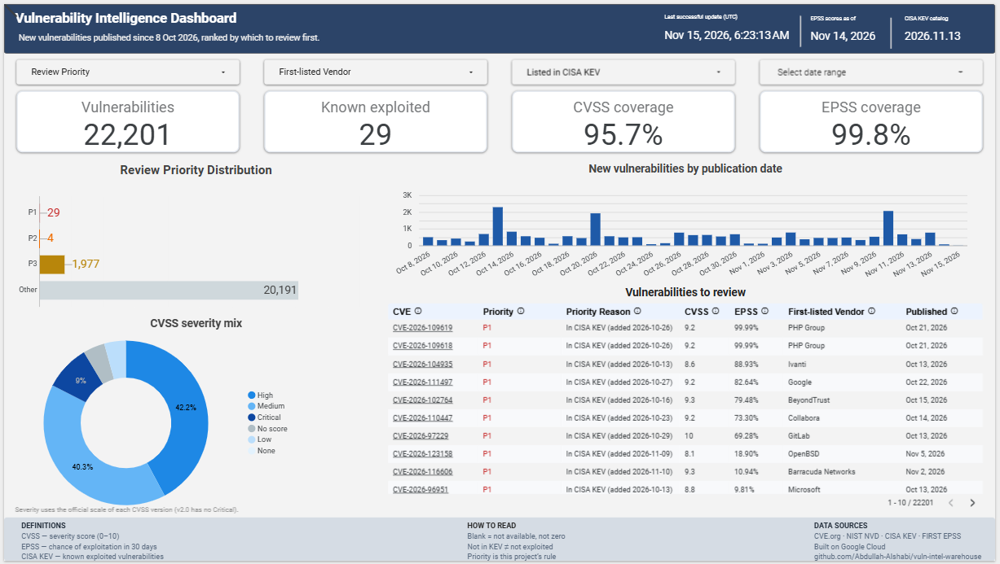
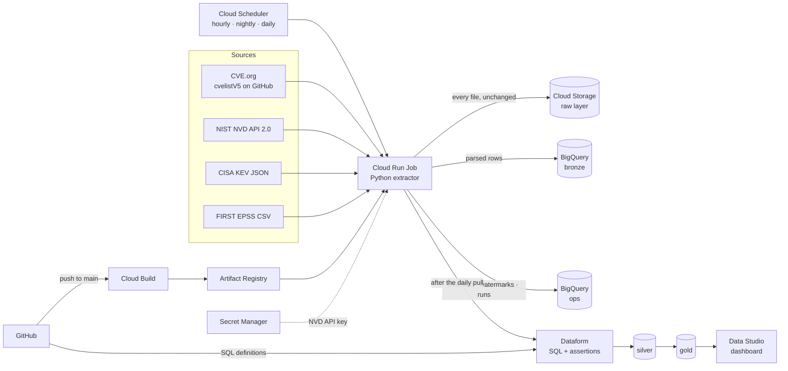
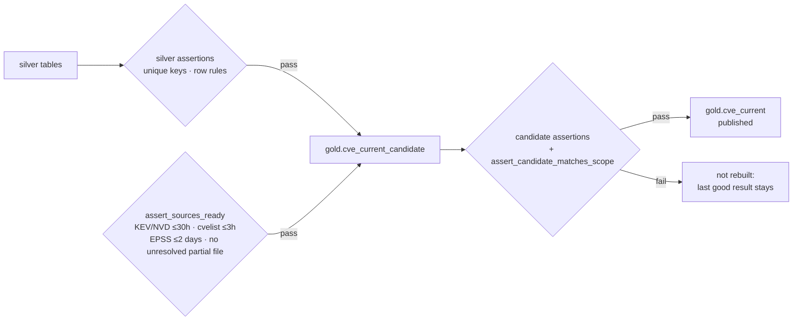

# Vulnerability Intelligence Warehouse

**An automated data warehouse on Google Cloud.** Every day it collects four public vulnerability sources, stores every file it downloads unchanged, cleans and joins the data in BigQuery, checks it, and publishes one table and a dashboard. The question it answers:

> *Of the vulnerabilities published since 8 October 2026, which should a security team review first, and why?*

**[Open the live dashboard (Data Studio)](https://datastudio.google.com/reporting/c48382ca-5378-49b0-b700-a0afa693d467)**



Graduation project, Tuwaiq Academy, *Data Engineering on Google Cloud*, by **Abdullah Alshabi** (November 2026).

---

## Contents
1. [What it does](#1-what-it-does)
2. [Results](#2-results)
3. [Architecture](#3-architecture)
4. [Data sources](#4-data-sources)
5. [How the pipeline runs](#5-how-the-pipeline-runs)
6. [Data model: raw → bronze → silver → gold](#6-data-model-raw--bronze--silver--gold)
7. [Business rules](#7-business-rules)
8. [Data quality and the publishing gate](#8-data-quality-and-the-publishing-gate)
9. [One vulnerability, end to end](#9-one-vulnerability-end-to-end)
10. [Testing and verification](#10-testing-and-verification)
11. [Security and operations](#11-security-and-operations)
12. [Why these tools](#12-why-these-tools)
13. [Repository layout](#13-repository-layout)
14. [Running it yourself](#14-running-it-yourself)
15. [Limitations](#15-limitations)
16. [Documentation](#16-documentation)

---

## 1. What it does
Thousands of new vulnerabilities (CVEs) are published every week, and no team can review them all. Four public sources each answer part of the question "which ones matter?":

| Question | Source |
|---|---|
| What is the vulnerability, and who reported it? | **CVE.org**, the official record |
| How severe is it? | **CVSS** scores from CVE.org and **NIST NVD** |
| Is it already being exploited? | **CISA KEV**, the catalog of known exploited vulnerabilities |
| How likely is it to be exploited in the next 30 days? | **FIRST EPSS**, a daily probability model |

The warehouse joins all four into **one row per vulnerability**. Each row has a **Review Priority**, the **reason** for that priority in plain English, and the source and date of every value used.

| Priority | Rule (checked in order; the first match wins) |
|---|---|
| **P1** | Listed in CISA KEV (known to be exploited) |
| **P2** | EPSS ≥ 10% (high probability of exploitation in 30 days) |
| **P3** | CVSS ≥ 9.0 (critical severity) |
| **Other** | None of the above. **This does not mean safe.** |

---

## 2. Results
The figures below are from the published result of 13 November 2026.

| Metric | Value |
|---|---|
| Vulnerabilities in scope (published since 8 Oct 2026) | **21,393** |
| P1, known exploited (CISA KEV) | **27** |
| P2, EPSS ≥ 10% | **3** |
| P3, CVSS ≥ 9.0 | **1,895** |
| Other | **19,468** |
| No CVSS score in the data used | 4.7% |
| No EPSS score (mostly CVEs newer than the EPSS file) | 1.4% |
| EPSS scores stored (one file per day since 8 Oct) | ~13.8 million rows (~405,000 per day) |

**What the numbers show:**
- **Only 30 of 21,393 new vulnerabilities (0.14%) are known or likely to be exploited.** Prioritising separates a short review list from the noise.
- **Publication volume is uneven.** Large spikes on some days (13 Oct, 20 Oct, 10 Nov) sit on top of a few hundred CVEs on a typical day.

---

## 3. Architecture


| Google Cloud service | Role in this project |
|---|---|
| **Cloud Storage** | Raw layer. Every downloaded file is stored unchanged and never overwritten. |
| **Cloud Run Jobs** | Runs the Python extractor: download, store raw, load bronze. |
| **Cloud Scheduler** | Starts the job on three schedules. |
| **BigQuery** | The warehouse: datasets `bronze`, `silver`, `gold` and `ops`. |
| **Dataform** | SQL transformations, dependencies, column descriptions and data-quality assertions, versioned in Git. |
| **Data Studio** (formerly Looker Studio) | The dashboard. It reads `gold.cve_current` only. |
| **Cloud Build + Artifact Registry** | CI/CD: a push to `main` that changes the extractor builds and deploys a new image. |
| **Secret Manager** | Stores the NVD API key and the Dataform GitHub token. |
| **IAM** | One service account per component, each with least privilege. |
| **Cloud Logging** | Structured JSON logs for every run. |

---

## 4. Data sources
| Source | What we use | How we read it | Frequency |
|---|---|---|---|
| [CVE.org cvelistV5](https://github.com/CVEProject/cvelistV5) | State, dates, CNA, title, description, affected products, CNA and ADP CVSS | GitHub release ZIPs: an hourly delta and a full nightly baseline | Hourly + nightly |
| [NIST NVD API 2.0](https://nvd.nist.gov/developers/vulnerabilities) | NVD analysis status, NVD CVSS | Incremental by `lastModified`, paginated, with an API key | Daily |
| [CISA KEV](https://www.cisa.gov/known-exploited-vulnerabilities-catalog) | Membership, `dateAdded`, ransomware use | The full catalog JSON | Daily |
| [FIRST EPSS](https://www.first.org/epss/) | EPSS score, percentile, model version | The full daily CSV | Daily, with automatic gap filling |

**Scope:** CVEs whose CVE.org `datePublished` is on or after **2026-10-08**. The cohort is fixed, not a rolling window: once a CVE is in scope, it stays in scope as long as its latest version qualifies.

---

## 5. How the pipeline runs
### Schedules (UTC)
| Schedule | Cron | What runs |
|---|---|---|
| `vuln-hourly` | `15 * * * *` | The CVE.org hourly delta |
| `vuln-baseline` | `40 0 * * *` | The full CVE.org baseline (a nightly safety net that catches anything an hourly file missed) |
| `vuln-daily` | `20 6 * * *` | NVD, then KEV, then EPSS, then the Dataform workflow (silver → gold) |

All three start the **same Cloud Run Job** with a different `MODE`. Other modes (`nvd`, `kev`, `epss`, `epss_backfill`, `epss_reprocess` and `dataform`) can be run by hand.

### What one ingestion does
```mermaid
sequenceDiagram
    participant Src as Source
    participant Job as Extractor (Cloud Run)
    participant GCS as Cloud Storage (raw)
    participant BQ as BigQuery (bronze/ops)
    Job->>BQ: take the source lock (one writer per source)
    Job->>Src: download (retries, size and status checks)
    Job->>GCS: store the file unchanged (if_generation_match=0, never overwritten)
    Job->>BQ: already processed this sha256? then record "unchanged" and stop
    Job->>Job: validate and parse (bad records are reported, never silently skipped)
    Job->>BQ: insert only new rows (dedupe on business key; any value conflict → nothing inserted)
    Job->>BQ: write the manifest entry (file, sha256, counts, status)
    Job->>BQ: move the watermark only if the file was complete
```

**The key properties:**
- **Raw is immutable.** Files are written with `if_generation_match=0`, so they can never be overwritten. The raw layer can rebuild bronze. This was tested by re-processing stored EPSS files and getting identical rows.
- **Loads are idempotent.** Running the same file again adds nothing. A different value for an existing key is reported as a *conflict* and nothing is inserted.
- **Every row is traceable.** Each bronze row carries the `batch_id` of the file it came from, and the manifest records each file's URI, sha256 and row counts.
- **A partial load is a failure.** A file with broken records, an invalid NVD response or a KEV catalog whose count does not match CISA's own count fails the run, and the watermark does not move.
- **Locks prevent overlap.** One lock per source, held in Cloud Storage, stops two runs from writing the same tables at the same time.

---

## 6. Data model: raw → bronze → silver → gold
| Layer | Where | What it holds |
|---|---|---|
| **raw** | `gs://vuln-intel-warehouse-raw/raw/<source>/ingest_date=YYYY-MM-DD/` | Every downloaded file, byte for byte |
| **bronze** | BigQuery `bronze` | One row per **stored version** of each record, plus the source JSON. Append-only. |
| **silver** | BigQuery `silver` (Dataform) | The **latest valid** version per CVE and source, and the chosen CVSS score |
| **gold** | BigQuery `gold` (Dataform) | The **published result**: one row per CVE in scope |
| **ops** | BigQuery `ops` | The manifest, watermarks, run log, EPSS day status and assertion results |

| Table | Grain | Purpose |
|---|---|---|
| `bronze.cvelist_records` | CVE × record version | Every CVE.org version we received |
| `bronze.nvd_records` | CVE × NVD version | Every NVD version we received |
| `bronze.kev_records`, `bronze.kev_snapshots` | Entry, and catalog membership per observation | What KEV said, and who was in each catalog |
| `bronze.epss_scores_v2` | CVE × score date | Every EPSS score for every day |
| `silver.cve_latest` | CVE | The newest CVE.org version, with scope applied after choosing it |
| `silver.nvd_latest` | CVE | The newest NVD version |
| `silver.kev_current` | CVE | Membership in the latest **valid** KEV catalog (stored members = CISA's count) |
| `silver.epss_latest` | CVE | Scores from the latest **complete** EPSS day |
| `silver.cve_metrics` | Score | Every CVSS score in the chosen versions, with provider and version |
| `silver.cvss_selected` | CVE | The one CVSS score chosen by the rule below, and why |
| `gold.cve_current_candidate` | CVE | The candidate result, built and checked first |
| **`gold.cve_current`** | CVE | **The published result**, copied from the candidate only if every check passes |
| `gold.coverage_summary` | One row | Summary counts computed from `gold.cve_current` |

Every gold column is documented in **[docs/data_dictionary.md](docs/data_dictionary.md)**: meaning, source, allowed values, what NULL means, and an example. The same descriptions are stored on the BigQuery columns and appear in the dashboard.

---

## 7. Business rules
### Choosing one CVSS score per CVE
A CVE can carry several CVSS scores, from different versions and providers. The project rule:
1. **Version:** 4.0, then 3.1, then 3.0, then 2.0.
2. **Provider, within the version:**
   1. the CNA via CVE.org;
   2. CISA-ADP via CVE.org;
   3. NVD-authored;
   4. another ADP;
   5. a non-NVD score read via NVD (the fallback).
3. **Scenario:** the GENERAL (or unspecified) scenario first.
4. **Score:** the highest base score among scores still tied, then a fixed tie-break.

Every gold row records the chosen score's version, provider, route (`cvelist` or `nvd`) and `cvss_selection_reason`. This is a project policy, not a claim that one provider is more accurate.

### Review Priority
The rule is a **sequential CASE**: P1 KEV, then P2 EPSS ≥ 10%, then P3 CVSS ≥ 9.0, then Other.
- **A missing value never counts as low.** It simply does not match, and the reason says it is unavailable.
- **`priority_reason` explains each row in words.** For example:
  - `In CISA KEV (added 2026-11-09)`
  - `Not in KEV; EPSS 1.65% is below 10%; CVSS 9.8 (v3.1, CNA microsoft) is at or above 9.0`
  - `Not in KEV; CVSS unavailable; EPSS unavailable. Not assessed as safe.`
- **The EPSS text is truncated, never rounded up past the threshold.** 0.09999 reads 9.99%, not "10.0% is below 10%".

This is a **general review priority**. It is not a remediation order for a specific organisation, and the thresholds are project choices, not industry standards.

---

## 8. Data quality and the publishing gate
**Gold is published only when every check passes.** If any check fails, `gold.cve_current` is not rebuilt, and the dashboard keeps showing the last good result together with its real build time.



| Check | Where |
|---|---|
| Uniqueness, not-null fields, value ranges, CVSS lineage, `is_kev` ↔ `kev_date_added` | Dataform assertions on silver and gold |
| Sources fresh and complete; NULL freshness counts as a failure | `assert_sources_ready` |
| Candidate = exactly the published CVEs in scope, in both directions; no duplicates | `assert_candidate_matches_scope` |
| 22 rules on bronze and ops (formats, dates, counts, completeness, unresolved work) | `infra/check_quality.sh` |
| An EPSS day is complete only if every loaded file of that day matches the table | `ops.epss_day_status` |

**Proved, not assumed:**
- A deliberate failing assertion was run on 11 Nov. The candidate was rebuilt, `gold.cve_current` was **skipped**, and it kept its earlier `updated_at`.
- The compiled Dataform graph confirms that gold depends on every check (`infra/show_deps.sh`).

---

## 9. One vulnerability, end to end
**CVE-2026-123158**: OpenSSH `sshd` on Linux with musl libc and without PAM. Trace it yourself with `bash infra/trace_cve.sh CVE-2026-123158`.

| Step | What the warehouse holds |
|---|---|
| **raw → bronze (CVE.org)** | 6 stored versions between 6 and 10 Nov; CNA `mitre` |
| **silver.cve_latest** | The newest version (10 Nov 04:55), OpenBSD / OpenSSH |
| **bronze → silver (NVD)** | Received (8 Nov) → Modified (10 Nov) → **Analyzed** (10 Nov) |
| **silver.kev_current** | Added to CISA KEV on **2026-11-09** (catalog 2026.11.10) |
| **bronze EPSS** | About 1% from 6 to 9 Nov, then **16.5%** on 10 Nov and **18.9%** on 11 Nov |
| **silver.cvss_selected** | **8.1**, CVSS v3.1, from the CNA (`mitre`) via CVE.org. NVD carries the same score as a secondary source, so the rule prefers the CNA. |
| **gold.cve_current** | **P1**: "In CISA KEV (added 2026-11-09)", CVSS 8.1, EPSS 18.9%, NVD Analyzed |
| **Dashboard** | Row 8 of the P1 table, linked to its cve.org record |

The EPSS score rose the day **after** the CVE was added to KEV. The data shows the order of events, not a cause.

---

## 10. Testing and verification
| Level | What | Result |
|---|---|---|
| **Offline unit tests** (`tests/test_offline.py`) | Parsing, scope, locks, retries, conflicts, partial files, NVD envelope and record validation, EPSS gaps, timestamp precision, error logging | **59 / 59** |
| **Integration on real BigQuery** (`tests/run_integration.sh`) | Re-processing from raw, idempotency, conflicts, KEV membership over time, EPSS completeness, **failure injection** (INSERT succeeds, manifest write fails, retry recovers) | **28 / 28**. Throwaway `test_` resources are deleted afterwards. |
| **Quality rules** (`infra/check_quality.sh`) | Production bronze and ops | **22 / 22** |
| **End-to-end verification** (`infra/verify_all.sh --baseline`) | Code; deployed version; schedules; quality; manifest → bronze → silver → gold re-derived; **stored raw files compared value by value with every layer**; the publishing gate | **All checks passed** |
| **Dashboard** | BigQuery counts against the dashboard: total, sum over days, P1 and the priority split | Identical |

The end-to-end run on **13 Nov 2026**, against the deployed extractor `f65f2a5`, compared:
- **all 405,484 EPSS scores** of the day gold used (0 differences);
- **the KEV catalog** (1,779 entries = CISA's count);
- **3 NVD pages**;
- **the full 662 MB CVE.org baseline**: 21,416 CVEs, 0 missing at any layer.

> The verification suite passed all implemented checks for the tested production state. It validates stored source files, selected raw-to-warehouse comparisons, transformation rules, and operational controls. It does not guarantee complete historical source delivery or establish the correctness of upstream source data.

Details and limits: **[docs/verification.md](docs/verification.md)**.

**External review.** An independent review, done with ChatGPT acting as a senior data engineer, found six issues: edge cases in recovery and validation, and the loss of fractions of a second in timestamps. All six (F1–F6) were fixed with failure tests, re-verified in production and signed off on version `f65f2a5`.

---

## 11. Security and operations
**Service accounts and permissions:**

| Service account | Can do |
|---|---|
| `extractor-sa` | Write raw files to the bucket, write bronze and ops, read the NVD secret, start Dataform as `dataform-sa` |
| `dataform-sa` | Read bronze; write silver, gold and ops (dataset level only, not the whole project) |
| `scheduler-sa` | Run the Cloud Run Job with overrides, nothing else |
| `build-sa` | Build, push and deploy the extractor image |

**Other controls:**
- **No key files.** The default compute service account is not used.
- **Secrets:** the NVD API key and the GitHub token live in Secret Manager. They are never in the code, logs or chat.
- **CI/CD:**
  - A push to `main` that touches `extractor/` builds, pushes and deploys the image. Every image is tagged with the commit SHA, and the job records it as `GIT_SHA`.
  - SQL changes need no new image, because Dataform reads them from Git.
  - Work is done on separate branches, tested, then merged.
- **Logs:** one structured JSON line per event, with `run_id` and `mode`. A failed run records the exception type and the stack trace.
- **Cost:** sized for the free trial. The job runs on 1 vCPU / 4 GiB with a 1-hour timeout. Queries are small, and the verification queries are capped at 5 GiB each.

---

## 12. Why these tools
- **Cloud Run Jobs + Python for ingestion.** The hard part is control: API pagination, retries, idempotency, locks, validation and never overwriting raw files. That is clearest as code, and it runs on demand with no servers to manage.
- **BigQuery + Dataform for transformations.** The data is modest (about 21 thousand CVEs, plus about 400 thousand EPSS rows a day), so plain SQL in BigQuery handles it in seconds. Dataform adds dependencies, assertions, documentation and Git versioning.
- **Why no Dataflow or Composer:**

> "I chose Cloud Run Jobs for ingestion in Python, to control the APIs, retries and idempotency. I ran the transformations inside BigQuery with Dataform, to manage dependencies and assertions. I didn't add Dataflow because the current requirements are met by the existing tools, with no need for an extra processing engine."

Cloud Scheduler is enough to orchestrate three schedules, so Composer would add cost and complexity without adding capability.

---

## 13. Repository layout
```
extractor/                 Python extractor (Cloud Run Job): main.py, Dockerfile, requirements.txt
definitions/
  sources/declarations.js  bronze and ops tables declared to Dataform
  silver/*.sqlx            cve_latest, nvd_latest, kev_current, epss_latest, cve_metrics, cvss_selected
  gold/*.sqlx              candidate, two custom assertions, cve_current, coverage_summary
workflow_settings.yaml     Dataform settings (cohort_start, assertion dataset)
cloudbuild.yaml            CI/CD: build → push → deploy the job
infra/                     setup and operations scripts
  setup_gcp.sh, iam.sh, secret.sh, registry.sh, job_iam.sh, dataform_iam.sh, scheduler.sh
  check_quality.sh         22 data-quality rules
  trace_cve.sh             follow one CVE through every layer
  dataform_run.sh          compile and run any branch as dataform-sa
  show_deps.sh             print the compiled Dataform dependencies
  verify_all.sh            end-to-end read-only verification
tests/
  test_offline.py          unit tests (no cloud)
  integration_bq.py, run_integration.sh   tests on real BigQuery in throwaway test_ datasets
  verify_warehouse.py      warehouse consistency checks
  verify_raw.py            raw files compared with every layer
docs/                      data dictionary, verification, dashboard (PNG/PDF)
```

---

## 14. Running it yourself
You need a Google Cloud project with billing (the free trial is enough), Cloud Shell, and an NVD API key.

```bash
git clone https://github.com/Abdullah-Alshabi/vuln-intel-warehouse.git && cd vuln-intel-warehouse
bash infra/setup_gcp.sh        # APIs, bucket, datasets
bash infra/iam.sh              # service accounts and least-privilege roles
bash infra/secret.sh           # NVD API key → Secret Manager (hidden input)
bash infra/registry.sh         # Artifact Registry repository
#  connect the Cloud Build trigger (2nd gen, runs as build-sa, included files extractor/** and
#  cloudbuild.yaml), push to main to build the image, and create the Cloud Run Job vuln-extractor
#  from it (extractor-sa, 1 vCPU / 4 GiB, 1-hour timeout)
bash infra/job_iam.sh          # roles that need the job to exist
bash infra/scheduler.sh        # the three schedules
#  create the Dataform repository vuln-intel-dataform, linked to this GitHub repository (main)
bash infra/dataform_iam.sh     # Dataform identity (dataform-sa, strict act-as) and BigQuery roles
```

**Then:**
```bash
python3 tests/test_offline.py              # unit tests
bash tests/run_integration.sh              # integration tests in throwaway test_ datasets
bash infra/verify_all.sh                   # read-only end-to-end check (add --baseline for the full CVE.org file)
bash infra/trace_cve.sh CVE-2026-123158    # follow one CVE
```

Do not run `infra/dataform_run.sh` or `verify_all.sh` while the daily job is running (06:20–06:40 UTC).

---

## 15. Limitations
| Limitation | What it means |
|---|---|
| **Current state only** | Gold shows the latest state. Raw and bronze keep earlier versions, but historical priority reporting ("what was the priority on date X") is not provided. |
| **First-listed vendor** | Vendor and product come from the first affected entry of the CVE record, as the CNA wrote it. Names are not normalised, so `Microsoft` and `microsoft` count as two vendors. |
| **Priority thresholds** | EPSS 10% and CVSS 9.0 are project choices. CVSS versions are not directly comparable. |
| **KEV** | Not in KEV does not mean not exploited. `Unknown` ransomware use does not mean no ransomware use. |
| **NVD coverage** | NVD is filtered by its own publish date with a two-day buffer. "Not in NVD data" means not in the NVD data we loaded. |
| **Upstream data** | The warehouse checks that it stores and transforms the sources faithfully. It does not verify the sources' own scores. |
| **Verification independence** | Some checks reuse the extractor's parser (`cve_row`, `canonical_hash`), so they prove consistency between stages, not a fully independent parse. The bronze → silver comparison approximates the state at build time. |
| **Known incident** | On 11 Nov 2026 the nightly baseline failed twice with an empty error. The failure cause remains unknown. No remaining data gap was found against the tested 12 and 13 November baselines. These checks do not rule out earlier ingestion delays or missed intermediate source versions. |

**Possible next steps:**
- normalise vendor names;
- add a historical, as-of view (SCD2);
- send alerts on failed runs;
- add a full-text search on the CVE description.

---

## 16. Documentation
| Document | Contents |
|---|---|
| [docs/data_dictionary.md](docs/data_dictionary.md) | Every gold column: meaning, source, allowed values, what NULL means, an example |
| [docs/verification.md](docs/verification.md) | The verified state, the method and its limits |
| [docs/dashboard.md](docs/dashboard.md) | The dashboard link, layout and display rules |

---

## License
MIT. See [LICENSE](LICENSE).

*Data: CVE® records © MITRE / CVE Program; NVD (NIST); CISA KEV; EPSS (FIRST). All are public sources, used as published.*
