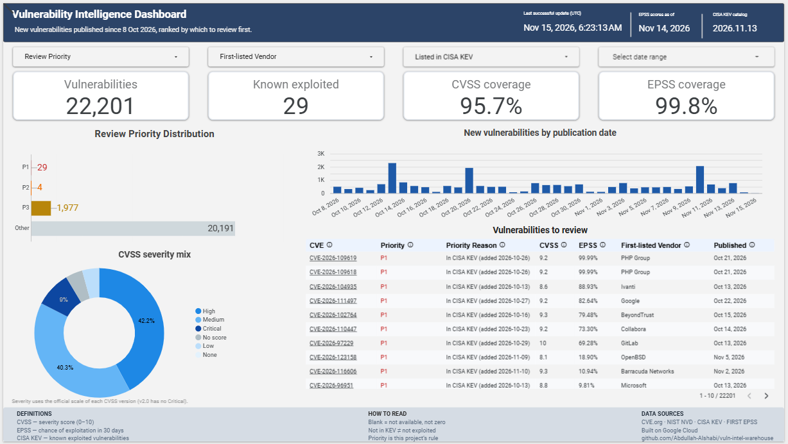

# Dashboard

**Live report (Data Studio, formerly Looker Studio):**
https://datastudio.google.com/reporting/c48382ca-5378-49b0-b700-a0afa693d467

Snapshot taken on 16 Nov 2026. It shows the published gold built on **15 Nov 2026 06:23 UTC** (EPSS scores of 14 Nov, CISA KEV catalog 2026.11.13).

## What it reads
`gold.cve_current` only, the published result behind the publishing gate. It never reads the candidate. Every card and chart is computed from that one table, so they all follow the filters.

## Layout
One landscape page, 1600 × 900, shown fit to width.

| Element | Shows |
|---|---|
| **Header** | Last successful update (UTC), the EPSS score date and the CISA KEV catalog version used. This is the pipeline's own time (`updated_at`), not Data Studio's cache time. |
| **Filters** | Review Priority, First-listed Vendor, Listed in CISA KEV, and a date range on the publication date (`published_at`) |
| **Cards** | Vulnerabilities, Known exploited (in CISA KEV), CVSS coverage, EPSS coverage (share of CVEs that have a score) |
| **Review Priority Distribution** | P1 / P2 / P3 / Other, in rule order, with counts |
| **CVSS severity mix** | The selected CVSS score in severity bands, using the official scale of its CVSS version (v3.x / v4.0: Critical ≥ 9.0, High ≥ 7.0, Medium ≥ 4.0, Low > 0, None = 0; v2.0 has no Critical: High ≥ 7.0). CVEs without a score are shown as "No score". |
| **New vulnerabilities by publication date** | Daily counts of the CVEs in the current result. This is not a history of priority changes. |
| **Vulnerabilities to review** | Sorted by priority, then EPSS, 10 rows per page. Each CVE links to cve.org, and column descriptions come from BigQuery. |

## Display rules
- **A missing score is shown blank, never 0.**
- **The EPSS text is truncated, not rounded,** so 0.99996 shows as 99.99% and 0.09999 as 9.99%.
- **Each priority keeps one colour everywhere:** P1 red, P2 orange, P3 gold, Other grey.
- **Every component uses `published_at` as its date range dimension**, so the date filter means "published between".
- **An empty selection shows "No data"**, never a 0% coverage or a new update time. The Vulnerabilities card shows 0.

## Check on 16 Nov 2026
Dashboard against BigQuery, gold built 15 Nov 2026 06:23 UTC:

| Case | Dashboard | BigQuery |
|---|---|---|
| No filters: total / known exploited | 22,201 / 29 | 22,201 / 29 |
| Priorities P1 / P2 / P3 / Other | 29 / 4 / 1,977 / 20,191 | 29 / 4 / 1,977 / 20,191 (sum 22,201) |
| CVSS / EPSS coverage | 95.7% / 99.8% | 95.7% / 99.8% |
| Severity mix High / Medium / Critical | 42.2% / 40.3% / 9% | 9,374 / 8,950 / 1,990 of 22,201 (42.2% / 40.3% / 9.0%) |
| Severity mix No score / Low / None | slices shown | 944 / 938 / 5 (all six bands sum to 22,201) |
| CVSS v2.0 scores ≥ 9.0 (affected by the v2 scale) | — | 0 |
| Date range 1–30 Nov 2026: total / known exploited | 7,877 / 12 | 7,877 / 12 |
| Date range 1–30 Sep 2026 (no data) | 0 CVEs; every other card, chart and the header show "No data" | 0 rows |
| Filter P1 | Total 29 = known exploited 29; the table shows 1–10 of 29; every chart and card follows the filter | 29 P1 rows, all in CISA KEV |
