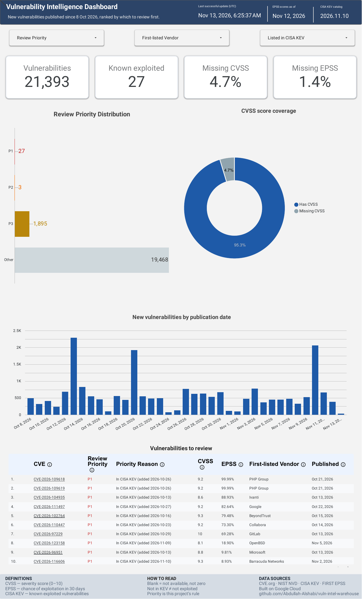

# Dashboard

**Live report (Data Studio, formerly Looker Studio):**
https://datastudio.google.com/reporting/c48382ca-5378-49b0-b700-a0afa693d467

Snapshot (PDF): [dashboard.pdf](dashboard.pdf). It shows gold built on 13 Nov 2026 06:25 UTC.

## What it reads
`gold.cve_current` only, the published result behind the publishing gate. It never reads the candidate. Every card and chart is computed from that one table, so they all follow the filters.

## Layout
| Element | Shows |
|---|---|
| **Header** | Last successful update (UTC), the EPSS score date and the CISA KEV catalog version used. This is the pipeline's own time (`updated_at`), not Data Studio's cache time. |
| **Filters** | Review Priority, First-listed Vendor, Listed in CISA KEV |
| **Cards** | Vulnerabilities, known exploited (KEV), % missing CVSS, % missing EPSS |
| **Review Priority Distribution** | P1 / P2 / P3 / Other, in rule order, with counts |
| **CVSS score coverage** | Share of CVEs with and without a CVSS score |
| **New vulnerabilities by publication date** | Daily counts of the CVEs in the current result. This is not a history of priority changes. |
| **Vulnerabilities to review** | Sorted by priority, then EPSS. Each CVE links to cve.org, and column descriptions come from BigQuery. |

## Display rules
- **A missing score is shown blank, never 0.**
- **The EPSS text is truncated, not rounded,** so 0.99996 shows as 99.99% and 0.09999 as 9.99%.
- **Each priority keeps one colour everywhere:** P1 red, P2 orange, P3 gold, Other grey.

## Check on 14 Nov 2026
BigQuery and the dashboard showed the same numbers:
- **Total:** 21,393, and the sum over publication days is also 21,393.
- **P1:** 27.
- **Priorities:** 27 + 3 + 1,895 + 19,468 = 21,393.
- **Filtering on P1** changed every element to 27.
